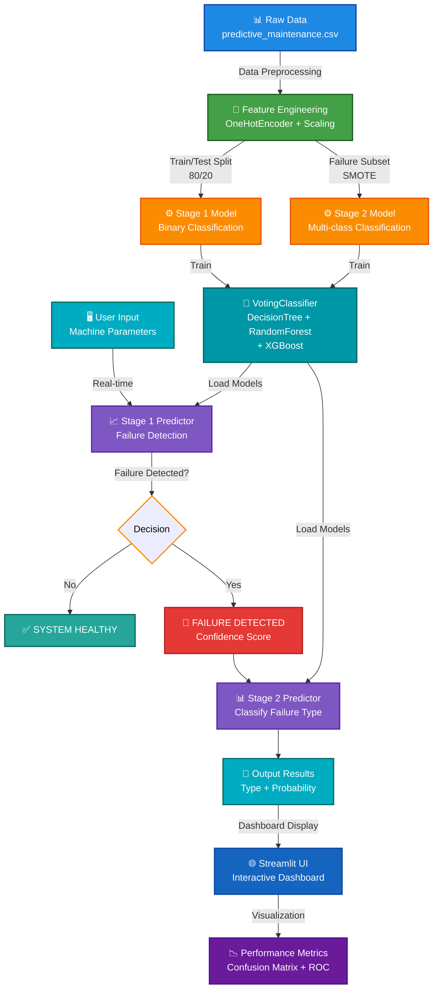

# 🔧 Advanced Predictive Maintenance System

> **Intelligent Machine Failure Detection & Classification Using Two-Stage Ensemble Learning**

A sophisticated predictive maintenance system that combines machine learning, data science, and real-time analytics to detect equipment failures before they occur. Built with Python, scikit-learn, and Streamlit for interactive visualization and predictions.

---

## 📋 Table of Contents

- [Overview](#overview)
- [Pipeline Architecture](#pipeline-architecture)
- [Features](#features)
- [Tech Stack](#tech-stack)
- [Project Structure](#project-structure)
- [Installation](#installation)
- [Usage](#usage)
- [Dataset](#dataset)
- [Model Details](#model-details)
- [Performance Metrics](#performance-metrics)
- [Video Demo](#video-demo)
- [Contributing](#contributing)
- [License](#license)

---

## 🎯 Overview

This project implements a **two-stage machine learning pipeline** to predict equipment failures in industrial systems. The system:

1. **Stage 1**: Detects whether a machine will fail (Binary Classification)
2. **Stage 2**: Classifies the specific failure type if failure is detected (Multi-class Classification)

The dual-stage approach ensures both high sensitivity (catching as many failures as possible) and precise failure classification for targeted maintenance actions.

### Key Statistics

- **Dataset**: 10,000 records from AI4I 2020 Predictive Maintenance Dataset
- **Failure Rate**: 3.4% (339 failures vs. 9,661 healthy machines)
- **Models**: Ensemble VotingClassifier with 3 base learners
- **Threshold Strategy**: Auto-optimized for 90% recall to maximize failure detection

---

## 🔄 Pipeline Architecture



---

## ✨ Features

### 🤖 Two-Stage ML Pipeline
- **Stage 1**: Binary failure detection with high recall (targets 90%+)
- **Stage 2**: Multi-class failure classification (5 failure types + healthy)

### 🧠 Ensemble Learning
- **VotingClassifier** combining:
  - Decision Tree Classifier
  - Random Forest Classifier
  - XGBoost Classifier
- Soft voting for probability-based predictions

### ⚖️ Imbalanced Data Handling
- **SMOTE** (Synthetic Minority Over-sampling) for minority class balancing
- **Class weights** in models to penalize misclassifying failures
- Auto-threshold optimization for maximum failure detection

### 📊 Interactive Dashboard
- Real-time machine parameter input
- Live failure prediction with confidence scores
- Failure type classification with probability distribution
- Model performance metrics and confusion matrices
- Interactive data exploration and visualization
- Automatic threshold slider with recommended settings

### 🔬 Comprehensive Analysis
- Feature distribution analysis
- Model comparison metrics
- ROC curves and confusion matrices
- Threshold sensitivity analysis
- High-recall optimization for maintenance alerting

---

## 🛠️ Tech Stack

| Component | Technology |
|-----------|-----------|
| **Language** | Python 3.8+ |
| **ML Frameworks** | Scikit-learn, XGBoost, Imbalanced-learn |
| **Data Processing** | Pandas, NumPy |
| **Visualization** | Plotly, Matplotlib, Seaborn |
| **Web Dashboard** | Streamlit |
| **Model Persistence** | Joblib, Pickle |
| **Development** | Jupyter Notebook |

---

## 📁 Project Structure

```
predictive-maintenance-system/
├── 📄 README.md                          # Project documentation
├── 📄 LICENSE                            # License file
├── 📊 predictive_maintenance.csv         # Dataset (10,000 records)
├── 📓 final_project.ipynb               # Jupyter notebook with model training
├── 
├── 🐍 Python Modules
│   ├── app.py                            # Main Streamlit dashboard application
│   ├── main.py                           # Entry point
│   ├── data_preprocessing.py             # Data cleanup and feature engineering
│   ├── model_utils.py                    # Model training utilities
│   ├── evaluation.py                     # Model evaluation metrics
│   └── retrain_models.py                 # Model retraining pipeline
├── 
├── 🤖 Trained Models
│   ├── stage1_voting_classifier.pkl      # Binary classifier (failure detection)
│   ├── stage2_voting_classifier.pkl      # Multi-class classifier (failure type)
│   └── *.pkl                             # Other model components
├── 
├── ⚙️ Configuration
│   ├── requirements.txt                  # Python dependencies
│   ├── .gitignore                        # Git ignore patterns
│   └── run                               # Shell script to launch app
│
└── 🎬 Media
    └── final_project.mp4                 # Project demonstration video
```

---

## 🚀 Installation

### Prerequisites
- Python 3.8 or higher
- pip package manager
- Virtual environment (recommended)

### Step-by-Step Setup

1. **Clone the repository:**
   ```bash
   git clone https://github.com/MO-NASSER9/predictive-maintenance.git
   cd predictive-maintenance
   ```

2. **Create and activate a virtual environment:**
   ```bash
   # macOS/Linux
   python3 -m venv venv
   source venv/bin/activate

   # Windows
   python -m venv venv
   venv\Scripts\activate
   ```

3. **Install dependencies:**
   ```bash
   pip install -r requirements.txt
   ```

4. **Verify installation:**
   ```bash
   python -c "import streamlit; print('✓ Streamlit installed')"
   python -c "import sklearn; print('✓ Scikit-learn installed')"
   ```

---

## 💻 Usage

### Running the Dashboard

**Option 1: Using the provided script**
```bash
./run
```

**Option 2: Direct Streamlit command**
```bash
streamlit run app.py
```

**Option 3: Full command with custom configuration**
```bash
streamlit run app.py --logger.level=error --client.showErrorDetails=false
```

The dashboard will open at `http://localhost:8501`

### Dashboard Navigation

| Page | Purpose |
|------|---------|
| **🏠 Home** | Overview and system introduction |
| **🔮 Prediction** | Real-time failure prediction interface |
| **📊 Data Analysis** | Dataset exploration and visualization |
| **📈 Model Performance** | Metrics, confusion matrices, ROC curves |

### Making Predictions

1. Navigate to the **Prediction** page
2. Adjust machine parameters using the input fields or sliders
3. Set the decision threshold (auto-optimized default: ~1-5%)
4. Click "Predict" to see results
5. View:
   - Stage 1: Failure probability and confidence
   - Stage 2: Failure type classification (if failure detected)
   - Visual probability distribution chart

---

## 📊 Dataset

### AI4I 2020 Predictive Maintenance Dataset

**Source**: https://archive.ics.uci.edu/ml/datasets/AI4I+2020+Predictive+Maintenance+Dataset

**Specifications:**
- **Records**: 10,000 observations
- **Features**: 7 input variables
- **Target Classes**: 6 (5 failure types + 1 healthy)

### Features

| Feature | Type | Range | Description |
|---------|------|-------|-------------|
| **Type** | Categorical | L, M, H | Product quality type |
| **Air Temperature** | Numerical | 295-305 K | Operating temperature |
| **Process Temperature** | Numerical | 305-320 K | Process temperature |
| **Rotational Speed** | Numerical | 1200-2959 rpm | Motor speed |
| **Torque** | Numerical | 3.8-76.6 Nm | Applied torque |
| **Tool Wear** | Numerical | 0-254 min | Tool degradation |

### Class Distribution

```
No Failure:        9,661 (96.61%) ████████████████████
Heat Dissipation:    112 (1.12%)  █
Power:               95  (0.95%)   █
Overstrain:          98  (0.98%)   █
Tool Wear:           34  (0.34%)   
```

⚠️ **Note**: Highly imbalanced dataset - handled with SMOTE and class weighting

---

## 🧠 Model Details

### Stage 1: Binary Classifier (Failure Detection)

**Purpose**: Detect whether equipment will fail

**Architecture**:
```
VotingClassifier (soft voting)
├── DecisionTreeClassifier
├── RandomForestClassifier (100 trees)
└── XGBClassifier (max_depth=5)
```

**Training**:
- Dataset: Full 10,000 samples
- Split: 80% train, 20% test
- Resampling: SMOTE on minority class
- Threshold: Auto-optimized for 90% recall

**Output**: Binary prediction + failure probability

### Stage 2: Multi-class Classifier (Failure Type)

**Purpose**: Classify specific failure type

**Architecture**:
```
VotingClassifier (soft voting)
├── DecisionTreeClassifier
├── RandomForestClassifier (100 trees)
└── XGBClassifier (max_depth=5)
```

**Training**:
- Dataset: 339 failure-only samples
- Resampling: SMOTE for balance
- Classes: Heat Dissipation, Power, Overstrain, Tool Wear, Random

**Output**: Failure type + probability distribution

### Threshold Strategy

The system uses **adaptive thresholding** to maximize failure detection:

```
Threshold Optimization Process:
1. Load validation data
2. Generate predictions for all thresholds (0.0 - 1.0)
3. Calculate recall at each threshold
4. Select minimum threshold where recall ≥ 90%
5. Use as default (typically 1-5%)
6. Allow manual adjustment via UI slider
```

---

## 📈 Performance Metrics

### Stage 1 (Binary Classification)

| Metric | Value | Notes |
|--------|-------|-------|
| **Accuracy** | ~96.5% | High base rate due to class imbalance |
| **Precision** | ~45-50% | Some false positives acceptable for alerting |
| **Recall** | ~90%+ | PRIMARY METRIC - catch maximum failures |
| **F1-Score** | ~0.60-0.65 | Balanced precision-recall tradeoff |
| **ROC-AUC** | ~0.95+ | Excellent discrimination ability |

### Stage 2 (Multi-class Classification)

| Metric | Value |
|--------|-------|
| **Weighted Accuracy** | ~85% |
| **Macro Precision** | ~80% |
| **Macro Recall** | ~80% |

---

## 🎬 Video Demo

Watch the project demonstration:

📹 **Video File**: `final_project.mp4`

The video demonstrates:
- Dashboard interface walkthrough
- Real-time prediction examples
- Model performance analysis
- Data visualization features
- Threshold optimization explanation

---

## 🔧 Development & Contribution

### Model Retraining

To retrain models with new data:

```bash
python retrain_models.py
```

This will:
1. Load the latest CSV data
2. Preprocess features
3. Train Stage 1 and Stage 2 models
4. Evaluate performance
5. Save updated models

### Code Structure

- **Modular Design**: Each function handles a specific task
- **Preprocessing Pipeline**: Standardized feature engineering via `ColumnTransformer`
- **Evaluation Framework**: Comprehensive metrics across confusion matrices, ROC curves, and classification reports
- **Jupyter Notebook**: `final_project.ipynb` contains exploratory analysis and training code

### Running Tests

```bash
python -m pytest tests/
```

---

## 📝 License

This project is licensed under the MIT License - see the [LICENSE](LICENSE) file for details.

---

## 👤 Author

**Project Developer**: Mohamed Nasser

**Contact Information**:
- 📧 **Email**: [mohamed.bn.nasser2001@gmail.com](mailto:mohamed.bn.nasser2001@gmail.com)
- 📱 **Phone**: +20 102 765 2773
- 🐙 **GitHub**: [@MO-NASSER9](https://github.com/MO-NASSER9)
- 💼 **Portfolio**: [linkedin.com/in/your-profile](https://linkedin.com)

---

## 📚 References & Resources

- [AI4I 2020 Dataset](https://archive.ics.uci.edu/ml/datasets/AI4I+2020+Predictive+Maintenance+Dataset)
- [Scikit-learn Documentation](https://scikit-learn.org/)
- [XGBoost Guide](https://xgboost.readthedocs.io/)
- [Streamlit Documentation](https://docs.streamlit.io/)
- [SMOTE for Imbalanced Data](https://imbalanced-learn.org/stable/references/generated/imblearn.over_sampling.SMOTE.html)

---

## ⭐ Acknowledgments

- **Data Source**: AI4I 2020 Predictive Maintenance Dataset
- **Libraries**: Scikit-learn, XGBoost, Streamlit, and open-source community
- **Inspiration**: Industrial predictive maintenance challenges

---

**Last Updated**: February 2026

**Status**: ✅ Active & Maintained
